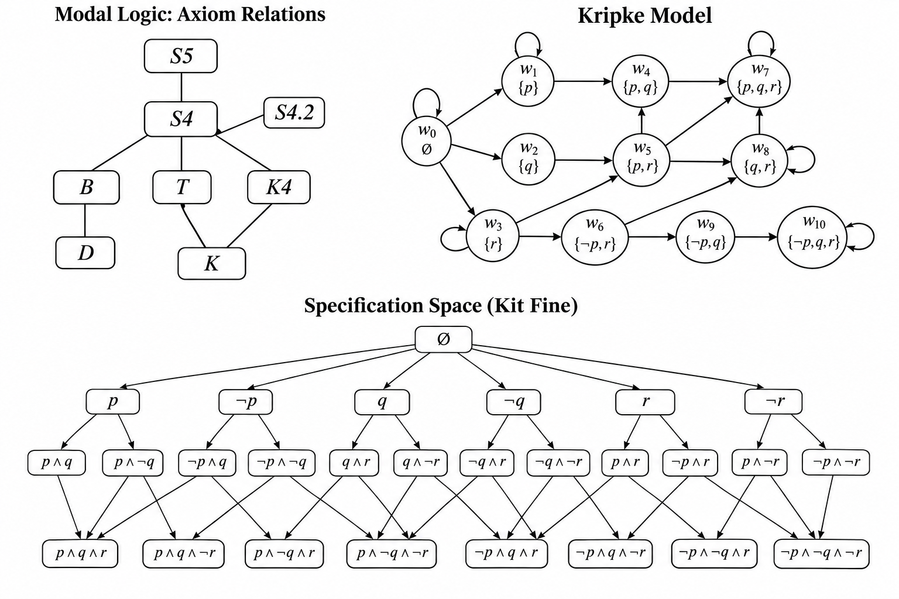

# A Novel Reply to the Argument From Evil

> https://www.thoughtscript.io/blog/000000000097.html.

An argument from the prior blog post is refined, formalized, and partially reformulated. 

The results here generally support the findings of **Leibowitz 1995**, **Plantinga 1977**, and **Speaks 2008** moving the prior arguments out of previously (and purely) Kantian, Modal contexts whilst attending to the nascent idea of "leveled" Moral Predicates.

It can be shown that such notions are generally compatible with widely accepted proof- and model- theoretic techniques (which should be encouraging to critics of Mackie). 

Perhaps helpfully, theologians (of all stripes) need not presuppose or rely upon ersatz **Moral Predicate Pluralism** (nor the "non-existence" of **Moral Predicates** - e.g. **Saeedimehr 2010** or **Semantic Nihilism** in Analytic or Anglo-American Philosophy). Importantly, the **Argument from Evil** (in its various formulations) have been run against almost *all* of the World's Major Religions (in particular order: Hinduism, Christianity, Islam, Confucianism, Judaism, Buddhism, etc.). To be clear, many Atheists will also benefit from the approach taken here (e.g - later Nietzsche famously argued that the “Death of God” would undermine all normative activities including Natural Science and Political Governance).

> A.I. helped generate some Bibliographic, `LaTeX`, and `Lean` files. Used a combination of ChatGPT and GitHub Copilot. Many things were misidentified by A.I. including mischaracterizations of **Tarski–Vaught Extensions** but think it should be mostly correct at this point. My [own](https://github.com/Thoughtscript/latex_docker) LaTeX editor was used to generate [resolution.pdf](./_pdf/resolution.pdf)

## An Ancient Debate

> "Mathematics is the language with which God has written the universe" - Galileo Galilei

A perennially vexing question of relevance to nearly every theologian, religion, and ethicist (including many famous Secular Humanists who also grappled with this issue).

## Syntactic and Semantic Conceptions of Logical Theories

**The Syntactic View** - places great emphasis on the Logical **Expressions**, **Well-Formed Formulae** (**WFF**s), **Schematic Proofs**, **Propositions** that constitute a **Logical Theory**.

**The Semantic View** - places greater emphasis on **Models**, **Model Classess**, **Satisfiability**, and backing **Structures** required to make **Logical Theories** `True`.

### Speaks 2008

Example reprised from the formulation in [Speaks 2008 pp. 2](https://academicweb.nd.edu/~jspeaks/courses/2007-8/20229/_HANDOUTS/problem-of-evil.pdf):

```plaintext
P1. God exists.
P2. If God exists, then God is wholly good.
P3. If something is wholly good, it always eliminates as much evil as
it can.
P4. If God exists, then God eliminates as much evil as God can. (2,3)
P5. If God exists, then God is omnipotent.
P6. If something is omnipotent, it can do anything.
P7. If God exists, then God can eliminate all evil. (5,6)
P8. If God exists, then God eliminates all evil. (4,7)
P9. God eliminates all evil. (1,8)
C. There is no evil. (9)
```

**Mackie's 1955** argument is presented as a seqeuence of **Propositions** (**Sentences**) with certain alleged formal characteristics: **Validity**, **Soundness**, etc. (E.g. - the **Syntactic View** above). Let's dub the above forumlation **[LPE 2008]**.

Philosophers and logicians have then historically quibbled over these various stipulated axioms/premises to show that the **Arugment** stands or falls. Significant progress in these narrow topics has typically accompanied the arrival of powerful new logical machinery.

## Plantinga's Free Will Defense

An **Argument** informed from **Modal Logic** showing that **[LPE 2008]** is **Invalid**. In **Modal (Kripke) Frame** terminology there are some **Possible Worlds** where one or more **Premises**/**Propositions** of the **Argument** might fail.

There are fairly straightforward relationships between **Modal (Kripke) Frames** and more general **Model Classes** (**Satisfying** some Set of **Sentences**). (This should come as no great surprise since **Modal (Kripke) Frames** are **Models** associated by way of the **Accessibility Relation**. **Local Satisfiability** at some **Possible World** is typically defined as a specific Model-Theoretic **Structure** **Satisfying** some **Propositions**).

## Newerish Mathematics

A surprising lack of inter-faith and inter-field dialouge presently permeates the topic. Perhaps this is unsurprising.

Some well-known and interesting Mathematical **Theorems**, results:

1. **Preservation Theorems**
1. **Herbrand's Theorem**
1. **Tarski-Vaught Extensions**
1. **Cohen Forcing and Lifts**
1. **Löwenheim-Skolem Theorems**

### Predicate Extensions and Satisfaction

A specific mathematical and formal property of interest (where `↪` is a **Structure Preserving Embedding**):

1. An **Extension** `P₀` for **Predicate** `P` used in the **WFF** of a **Theory** `THₚ₀` defined on **Structure** `S₀`.
1. An **Extension** `P₁` for **Predicate** `P` used in the **WFF** of a **Theory** `THₚ₁` defined on a **Structure** `S₁` such that `P₀ ≠ P₁` and `S₀ ↪ S₁`.

Such that:
1. `S₀ ⊭ THₚ₀` 
1. `S₁ ⊨ THₚ₁` 
1. `THₚ₀` is lexiographically isomorphic to `THₚ₁` (`THₚ₀ = THₚ₁`).
1. An example **Predicate** `P`: `"It's true there are 7 of something"`.
    * `S₀` has `6` of something so, `S₀ ⊭ THₚ₀`.
    * `S₁` has `7` of something so, `S₁ ⊨ THₚ₁`.

Two other helpful **Definitions**:
1. **Outright Contradiction** - a **Formal Proof** where some **Proposition** (or **Sentence**) `P ∧ ¬P` is derived for some **Proposition** (or **Sentence**) `P` in every **Structure** `S`.
1. **Possible (Seeming) Contradiction** - a **Formal Proof** that's **Sound** or **Valid** where some **Proposition** (or **Sentence**) `P ∧ ¬S ∧ ¬(P ∧ ¬S)` is derived for some **Proposition** (or **Sentence**) `P` in some **Structure** `S` (but not necessarily all). E.g. - a "seeming" **Contradiction** that arises from the implicit or explicit **Structure** that's chosen to reason about `P ∧ ¬S` in.
1. Call a **Structure** `S₁` with the following properties a **Resolution**:
    * `S₀ ↪ S₁`
    * `S₀ ⊭ THₚ₀` 
    * `S₁ ⊨ THₚ₁`
    * `THₚ₀ = THₚ₁`

> This insight confirms **Plantinga's** result that **[LPE 2008]** suffers from a fatal flaw: it doesn't substantively prove that **Complex Predicates** are **Outright Contradictions** nor that they *aren't merely* **Seeming Contradictions** **Resolved** under **Cohen Forcing** or **Lift** to parent **Models**/under a super **Class**. (**Note**: This characterizes many philosophical debates.)

This holds outside of the machinery of **Modal Logic**.

### Contradictions and Disjoint Sets

A second line of criticism focuses on the use of **Complex Predicates**:

1. A historically common definition: a **Complex Predicate** `P` is defined as a a **Logical Equivalence** (through **Howard-Curry Isomorphism**) of a **Conjunction** or **Disjunction** of other **Predicates**: e.g. - `P(x) ↔ S(x) ∧ R(x) ∧ Q(x)` or `P(x) ↔ S(x) ∨ R(x) ∨ Q(x)` (familiarly found in **Multiple Realizability** debates).
1. Many theologians have criticised **Mackie 1955** as presupposing hidden premises, **Propositional** lacunas, or Inferential Profile/Axiom Definition (characterizing **Predicates**) and the criticism here generally aligns with this kind of critique against **[LPE 2008]**.

Consider the following **Complex Predicate**:
1. `P(x) ↔ (S(x) ∧ R(x) ∧ Q(x))` - **Local** or **General Definition**
    * One must substantially show that `P` is exhaustively characterized by `(S(x) ∧ R(x) ∧ Q(x))`. (**Note**: This characterizes many philosophical debates.)
    * Given that the **Extensions** of `S`, `R`, `Q` can vary on. the **Structure** (per the above). One must show that the Inferential Profile/Axiom Definition holds not just a specific **Model** (but in all relevant ones).
1. **Second-Order Realizability**
    * Variant of the above, one must show that a **Definition** for a **Complex Predicate** isn't *merely* a **Disjunct**.
    * I dislike importing the philosophical jargon term **Multiple Realizability** but I think it's fairly forward and familiar in this context. The idea being that multiple conditions can **Disjunctively Satisfy** the **Definition** for a (**Complex**) **Predicate** `P`. **Second-Order Realizability** involves precisely fixing the relevant **Disjunctions** - a trivial property I've called: [Exhaustive OR](https://www.thoughtscript.io/blog/000000000161).
        * Rephrasing this formulation slightly: to prove conclusively that a **Complex Disjunctive Definition** is an **Exhaustive OR**.
    * To be clear: this *is not* the Logical claim: `(p ↔ (q ∧ r)) → (p ↔ ((q ∧ r) ∨ z))` which **is not** a **Logical Tautology**.
        * It'd be closer to: `¬(p ↔ (q ∧ r)) ∧ (p ↔ ((q ∧ r) ∨ z))` for some **Definition** of **Complex Predicate** `P`. (e.g. - the denial that the left-hand is correct in the first place.)
1. All **Conjunctions** have **Disjunctive Logical Equivalences** in **Classical** (and **Nonclassical**) **Logic** so the above considerations are relevant to these discussions.

> So, the upshot is that in lieu of such proves and **Definitions** we have no reason to accept that a particular **Complex Predicate Definition** holds **Locally**, **Globally**, or isn't **Resolved** (in the manner of **Resolution** defined above) in a *higher or lower* **Structure**. Again, this is why the **Argument** here is **Meta-Schematic** since.

On the topic of **Predicate Extensions**:
1. **Extension** of some **Predicate** is typically codefined with its **Anti-Extension** (or **Complement**, **Disjoint Set**).
2. …

### Meta-Schematic Argument

We shall here take a predominantly *Meta-Schematic* approach to defend or attack a swathe of the logical space in the debate. We aim to "knock out" all permutations of a class of argument kinds.

An **Argument** `A` that is **Sound** and **Valid** in and **Satisfied** by a **Model** `M` might not be in some **Structure** `N` where `N ↪ M`. Two immediate takeaways: (a) this is consistent with there being some **Possible World** where **[LPE 2008]** fails - is either **Invalid** or **Unsound**; or (b) this is consistent with some **Models** having vacuously defined **Extensions**, etc.

There are some further insights that go beyond the prior findings. For example:
1. Since any **Structure** `S` can be extended (in the various well-established ways described before) indefinitely, a conclusive Proof for the Non-Existence of God must be proved **Globally** across all **Models**, **Structures**.
1. No such Argument or technique/method of **Arguments** exists to do this arbitrarily across all such Set Theoretic **Strcutures** (and Number Theoretic Induction doesn't apply here since the **Successor Function** isn't at play).
1. Moreover, there are competing views on the way that we're to understand the overall hierarchy and arrangement of **Structures** to each other.
    * The well-known debates surrounding `S4` and `S5` **Modal Logic** for example.
    * Others like **Kit Fine's 1975 Specification Spaces** which specify the exact relations that hold between **Models**.
    * Consider:

        

        Each "block" or "circle" in the image above can be thought of as a **Structure** that **Satisfies** some **Proposition** (**Model**). And that depends on the underlying "topology" (if you will) of the universe (or "domain of discourse") at hand. There's no guarantee that one can Prove that some **Proposition** will hold across **Induction** from some arbitrary **Local** position in the **Global Topology**.
1. Therefore, **Arguments** like **[LPE 2008]** cannot guarantee that they meet this basic **Soundness** criterion without first affixing the background "theory landscape" (**Global Topology**) and mapping out all the relationships between **Extensions**, **Structures**, **Predicates**, and **Models**.
1. And, given the concerns above surrounding the correct **Inferential Profiles** for **Complex Predicates** (in even trivial **Model Extensions/Embeddings** much less *all of them*) this should cast serious doubt on all **Arguments** schematic akin to **[LPE 2008]**. (This is itself a perhaps familiar style of reply since it mirrors sophisticated arguments in Philosophical Skepticism and Formal Epistemology debates.)

As such, we will show that this Structure entails that *all* **Arguments** with the following formal properties will likewise fail:

…

## Summary

The **Meta-Schematic Approach** taken above is consistent with and broadly supports a wide-range of existing replies but offers some original insights and moves that can be made...

This should be considered a broad win for any theist (although it doesn't "prove the existence of God").

### Speaks 2008

Critics of **[LPE 2008]** *need not* to deploy the following architecture for their view:
1. *N*-many moral **Predicates**.
1. Which would also seem to necessitate an infinite number of so-called **Bridge Laws** linking each **Predicate** to each other. (A property of various **Theories** that's traditionally been considered a liability: e.g. - unnecessarily plenitudinous and/or profiligate.)

We offer the **Semantic Conception** approach as a viable alternative:
1. Lexiographic Isomorphism of Formal **Theories** is a plausible criterion for linguistic identity (`THₚ₀ = THₚ₁`) reducing the need for *N*-many moral **Predicates** to one (and sans all the **Bridge Laws**).
1. There are existing techniques to define a top-level **Predicate** using standard-fare presuppositions (such an approach is taken in [Zhao 2012](https://logic.pku.edu.cn/ann_attachments/the%20outline%20of%20a%20new%20solution%20to%20the%20liar%20paradox134720412881.pdf) within the **Liar Paradox** debates). Such an approach is broadly compatible with the techniques advanced above.

### God Beyond 'God'

Suprisingly, Hegelian in the following exact sense:

…

It's also suprisingly Nietzchean in the following exact sense:

1. `God` as a **Word** …

Nearly every world religion and great work on the topic:

"In fact, it is widely admitted by almost all major religions that this is the case (e.g. that human limitations render such conceptions as admittedly crudely and inaccurately representational).

In other words, that our human understanding of the divine is partly accurate, often not, and incomplete - that some part of God is known or knowable and the rest not or impossible to understand."

…

## Resources and Links

1. https://www.thoughtscript.io/blog/000000000097
1. https://www.hughlafollette.com/papers/Plantinga_on_the_Free_Will_Defense.pdf
1. https://en.wikipedia.org/wiki/Alvin_Plantinga%27s_free-will_defense
1. https://www.researchgate.net/publication/306104445_Theodicy_as_the_Justified_Demands_of_Atheism_Yeshayahu_Leibowitz_Versus_Emmanuel_Levinas
1. https://academicweb.nd.edu/~jspeaks/courses/2007-8/20229/_HANDOUTS/problem-of-evil.pdf
1. https://philpapers.org/archive/HOWTLP-2.pdf
1. https://eijh.modares.ac.ir/article_17698_c7f746b7939ba6db31093d4438d9207b.pdf
1. https://logic.pku.edu.cn/ann_attachments/the%20outline%20of%20a%20new%20solution%20to%20the%20liar%20paradox134720412881.pdf
1. https://semantics.uchicago.edu/kennedy/classes/s06/readings/fine75.pdf
